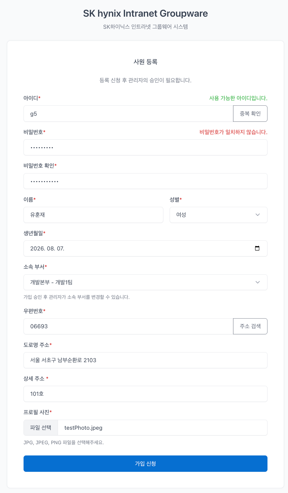

# Intranet Groupware

---

# 1. 사원 등록

## 구현 과정

1) HTML UI 적용 (Bootstrap Tabler)

2) DB `employee`, `department` 테이블 생성
  - `employee.department_id(FK)`는 `department.department_id(PK)`를 참조
  - `department : employee = 1 : N`

3) MyBatis Mapper Interface / Mapper XML 작성

4) Service 작성

5) Controller 작성

6) JavaScript ID 중복 및 유효성 검사

7) 주소 API 연동

8) 프로필 사진 업로드 구현
  - `MultipartFile` 사용
  - JPG / JPEG / PNG 제한
  - 5MB 용량 제한
  - UUID 파일명 생성
  - `uploads/profile` 경로에 실제 파일 저장
  - DB에는 이미지가 아닌 이미지 경로만 저장

9) 사원번호 자동생성 구현
  - 현재 연도 4자리 + 난수 4자리 조합(예: `20260037`)
  - DB에 `UNIQUE` 제약조건 적용
  - 생성된 사원번호가 기존 DB에 존재하는지 조회 및 중복된 경우 새로운 난수를 생성하여 다시 조회
  - 중복되지 않은 사원번호가 생성될 때까지 `while(true)` 반복문 사용

10) 사원 등록 전체 테스트

## 주요 이슈

### 1. ImageHandler 의존성 주입 오류

프로필 사진 업로드 로직을 수행하는 `ImageHandler` 클래스를 별도로 작성한 뒤  
Controller에 의존성 주입하는 과정에서 오류가 발생했다.

- `ImageHandler`가 Spring Bean으로 등록되지 않은 것이 원인
- `@Component`를 사용하여 Bean으로 등록하여 해결
- 이 과정에서 `@RequiredArgsConstructor`와 생성자 주입의 동작 원리를 이해

### 2. Controller와 Service 반환 타입에 대한 혼동

Controller와 Service의 반환 타입을 동일하게 맞춰야 한다고 생각했다.

- 각 메서드는 독립적이므로 반환 타입이 일치할 필요가 없음
- Service가 `int`를 반환하더라도 Controller에서 반환값이 필요하지 않다면 호출만 할 수 있음
- Service의 반환값을 View에서 사용하고 싶다면 Controller에서 `Model`에 담아 전달

예시:

```java
int result = empService.empSignUp(params);
model.addAttribute("result", result);

return "index";
```

View에서는 다음과 같이 사용할 수 있다.

```html
<span th:text="${result}"></span>
```

### 3. JavaScript 함수 내부의 return 동작 이해

`if`문 내부에 `return`이 존재할 경우 `if`문만 종료되는 것이 아니라  
`return`이 속해 있는 함수 전체가 종료된다는 점을 이해했다.

## 회원가입 유효성 검사 흐름

```text
              [form submit 발생]
                       │
                       ▼
            ID 중복확인 했는가?
                       │
             ┌─────────┴─────────┐
             │                   │
            아니오                예
             │                   │
             ▼                   ▼
      preventDefault()       비밀번호 형식 검사
         가입 중단                  │
                          ┌───────┴───────┐
                          │               │
                         실패              성공
                          │               │
                          ▼               ▼
                   preventDefault()   비밀번호 확인값과
                      가입 중단          같은지 검사
                                          │
                                   ┌──────┴──────┐
                                   │             │
                                  다름            같음
                                   │             │
                                   ▼             ▼
                            preventDefault()   이름 정규식 검사
                               가입 중단              │
                                              ┌─────┴─────┐
                                              │           │
                                             실패          성공
                                              │           │
                                              ▼           ▼
                                       preventDefault()  정상 제출
                                          가입 중단          │
                                                           ▼
                                                    POST /signUp
                                                           │
                                                           ▼
                                                      Controller
```

## 구현 결과

최종적으로 구현된 사원 등록 화면이다.



---

# 2. 사원 조회 및 수정

## 구현 과정

1) MyBatis Mapper Interface / Mapper XML 작성

2) Service 작성

3) Controller 작성  
  - 사원 정보 페이지 / 사원 정보 수정 페이지는 authentication를 통해 security Context에 저장된 로그인 ID를 추출하여 사원 정보 조회
    (security Context는 세션에 저장되어 있음)

4) view 작성
myPage.html
 - 데이터 표현은 더미리프 문법 th:if를 통해 표현.
myPageModify.html 작성
 - 데이터 표현은 더미리프 문법 th:if를 통해 표현.
 - 정보를 수정을 할 수 있도록 <input>에 기존 데이터를 표현.

## 주요 이슈
- 프로필 사진 수정 후 사원 정보 페이지에서 사진이 깨지거나 변경되지 않음.
사진 폴더의 경로가 정적 리소스 폴더인 static 아래에 있었기 때문에 사진을 읽을 수 없었으며 서버를 재실행해야만 다시 사진을 불러올 수 있었음.
따라서 폴더의 경로를 static 리소스 영역에서 빼낸 후 WebConfig 클래스를 작성하여 해결하였다.
WebConfig 클래스는 프로젝트와 외부 파일을 연결하는 클래스이다.

- View에서 form 태그의 action의 경우 더미리프 문법 @{/goEmpModify}로 표현.
스프링 시큐리티를 적용함으로써 CSRF 토큰 처리를 위해 사용했으며 일반 "/goEmpModify}"로 표현 시 404에러가 발생할 수 있음.

- 사원 정보 수정을 할 때 데이터를 수정하지 않고 수정 시, JS 패턴에 의해 수정이 되지 않음. 
첫 번째 ID 이슈,  
ID 중복확인을 거치지 않으면 JS에 의해 중복확인을 요구.
따라서 중복확인 버튼을 true로 선언하여 페이지 로딩 시 중복확인을 이미 실행한 상태로 변경.
if문을 활용하여 중복확인이 false인 경우(사용자가 ID를 수정했을 경우 false가 됨)에만 중복확인 요구를 발동하도록 수정.

두 번째 비밀번호 이슈, 
비밀번호를 변경하지 않는 경우 공백 데이터가 서버로 전송하도록 변경 + JS에선 공백 아닐 경우에만 JS 패턴 적용.
이후 xml에서 if문을 활용하여 공백이지 않을 경우에만 데이터를 update 하도록 수정.
공백 데이터를 활용함으로써 기존 BCrypt 비밀번호 또한 보존 가능해짐.

세 번째 프로필 사진 이슈, 
사진을 변경하지 않을 경우 컨트롤러와 xml에서 if문으로 사진 업로드 로직을 수행하지 않도록 예외 처리.


---

# 4. 사원 전체 조회

> 구현 예정

---

# 3. 사원 삭제

> 구현 예정
