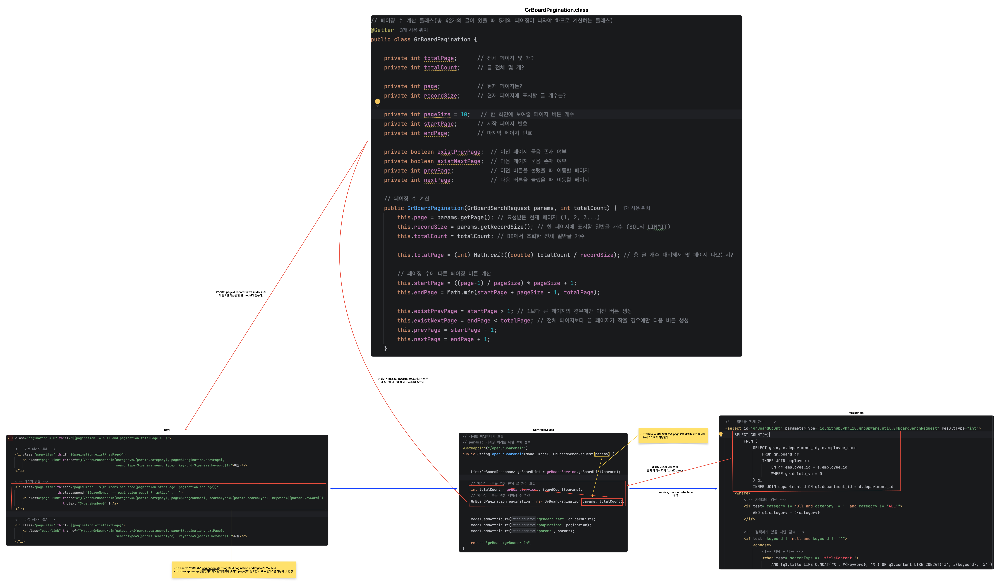

# Intranet Groupware

---

## 1. 게시글 작성

> 게시글 작성 기능은 로그인한 사원의 정보를 기준으로 게시글을 등록하는 것을 목표로 한다.

1. HTML UI 적용 (Bootstrap Tabler)
2. DB `grBoard` 테이블 생성
  - `grBoard.employee_id(FK)`는 `employee.employee_id(PK)`를 참조
  - `employee : grBoard = 1 : N`
  - 사원 1명이 여러 개의 게시글 작성 가능
3. MyBatis Mapper Interface / Mapper XML 작성
4. Service 작성
5. Controller 작성
6. 게시글 작성 테스트

> **한줄요약**  
> 로그인한 사원 정보를 조회한 뒤 게시글 데이터와 `employeeId`를 함께 DB에 저장한다.

---

## 2. 게시글 목록

> 게시글 목록은 **작성된 게시글을 최신순으로 조회하고, 작성자와 부서 정보를 함께 출력하는 것**을 목표로 한다.

1. HTML UI 적용 (Bootstrap Tabler)
2. MyBatis Mapper Interface / Mapper XML 작성
  - `employee`, `department`, `grBoard` 테이블 다중 JOIN 처리
  - 다중 조회 결과이므로 `List<>` 타입으로 반환
3. Service 작성
4. Controller 작성
5. `ROW_NUMBER() OVER()`을 활용해 게시글 순번을 내림차순으로 처리
6. `ORDER BY`를 활용해 공지사항을 목록 최상단에 배치
7. 게시글 카테고리별 조회 처리
8. 검색 기능 처리
9. 플로우차트 작성


[게시글 목록 플로우차트 PDF 보기](/assets/img/boardAll.pdf)

> **한줄요약**  
> Mapper XML에서 게시글·사원·부서 정보를 JOIN하여 조회한 뒤  
> Controller에서 조회 결과를 Model에 담아 HTML에 출력한다.

---

## 3. 페이징 처리

> 페이징 처리는 **전체 게시글 중 현재 페이지에 필요한 데이터만 조회하는 것**을 목표로 한다.

1. `page`, `recordSize`, `offset`을 이용해 조회 범위 계산
2. `getOffset()`을 이용해 조회 시작 위치 계산
3. SQL의 `LIMIT`, `OFFSET`을 이용해 한 페이지에 출력할 게시글 개수 제한
4. 플로우차트 작성


[페이징 처리 플로우차트 PDF 보기](/assets/img/pagingPlus.pdf)

> **한줄요약**  
> 사용자가 페이지 번호를 선택하면 `page` 값이 요청 파라미터로 Controller에 전달된다.  
> Spring MVC가 해당 값을 `params.page`에 자동 바인딩하고,  
> `recordSize`와 `getOffset()`을 이용해 SQL의 조회 범위를 계산한다.

---

## 4. 페이징 버튼

> 페이징 버튼은 **현재 페이지와 전체 페이지 수를 기준으로 사용자가 원하는 페이지로 이동할 수 있도록 구현하는 것**을 목표로 한다.

1. 현재 페이지 기준 페이지 블록 계산
2. 이전 / 다음 페이지 이동 처리
3. 페이지 번호 선택 처리
4. 검색 및 카테고리 조건 유지
5. 플로우차트 작성



[페이징 버튼 플로우차트 PDF 보기](/assets/img/pagination.pdf)

> **한줄요약**  
> 전체 게시글 수와 현재 페이지를 기준으로 페이지 버튼을 생성하고,  
> 선택한 페이지 정보를 다시 서버에 전달하여 해당 범위의 게시글을 조회한다.

---

## 5. 게시글 조회

> 게시글 조회는 **선택한 게시글의 상세 내용을 출력하고 접근 권한 및 조회수를 처리하는 것**을 목표로 한다.

1. HTML UI 적용 (Bootstrap Tabler)
2. MyBatis Mapper Interface / Mapper XML 작성
3. Service 작성
4. Controller 작성
  - 게시글 상세 정보 조회
  - 게시글 조회 시 조회수 증가 처리
  - 비밀글은 작성자 외 접근 불가 처리
  - 비밀글 접근 실패 시 알림 메시지 출력
  - 접근 실패 후 기존 페이지로 돌아갈 수 있도록 조회 조건 유지

> **한줄요약**  
> 게시글 ID를 기준으로 상세 정보를 조회하며,  
> 비밀글인 경우 현재 로그인한 사원의 `employeeId`와 게시글 작성자의 `employeeId`를 비교하여 접근 여부를 결정한다.

---

## 6. 게시글 수정

> 게시글 수정은 **작성자 본인만 기존 게시글 내용을 변경할 수 있도록 구현하는 것**을 목표로 한다.

1. HTML UI 적용 (Bootstrap Tabler)
  - 작성자가 아닌 경우 수정 버튼 노출 제한
2. MyBatis Mapper Interface / Mapper XML 작성
3. Service 작성
4. Controller 작성
  - 게시글 수정 처리
  - 수정 완료 후 게시글 상세 페이지로 이동
  - 수정 완료 알림 메시지 처리

> **한줄요약**  
> 게시글 ID를 기준으로 기존 데이터를 수정하고,  
> 수정 완료 후 해당 게시글 상세 페이지로 이동한다.

---

## 7. 게시글 삭제

> 게시글 삭제는 **작성자 본인만 게시글을 삭제할 수 있도록 구현하는 것**을 목표로 한다.

1. HTML UI 적용 (Bootstrap Tabler)
  - 작성자가 아닌 경우 삭제 버튼 노출 제한
2. MyBatis Mapper Interface / Mapper XML 작성
  - 게시글 삭제 조건은 게시글 식별번호 `grBoardId` 사용
3. Service 작성
4. Controller 작성
  - 게시글 삭제 처리
  - 삭제 완료 후 게시판 메인 페이지로 이동
  - 삭제 완료 알림 메시지 처리

> **한줄요약**  
> `grBoardId`를 기준으로 게시글을 삭제하고,  
> 삭제 완료 메시지와 함께 게시판 목록으로 Redirect한다.

---

## 주요 이슈 및 학습 내용

### 1. 로그인 식별값 처리

게시글 작성 기능을 구현하는 과정에서 `CustomUserDetailsService`의 다음 코드를 변경하였다.

기존:

`username(employeeNum)`

변경:

`username(loginKey)`

게시글 작성 시 현재 로그인한 사용자의 정보를 조회하기 위해서는  
로그인에 실제로 사용한 값인 **사번 또는 ID를 모두 처리할 수 있어야 했기 때문**이다.

기존처럼 `employeeNum`으로 고정할 경우 ID로 로그인하더라도  
`Authentication.getName()`에서 사번이 반환되는 문제가 있었다.

따라서 로그인 시 사용한 값을 `loginKey`로 저장하도록 변경하였다.

---

### 2. 비밀글 접근 제한

비밀글은 게시글 작성자만 조회할 수 있도록 처리하였다.

게시글의 `employeeId`와 현재 로그인한 사원의 `employeeId`를 서버에서 비교하여  
두 값이 다를 경우 상세 페이지 접근을 제한한다.

이 과정에서 HTML에서 전달받은 `employeeId`를 신뢰하기보다,  
게시글 ID를 기준으로 DB에서 작성자 정보를 조회한 뒤 서버에서 비교하도록 구현하였다.

---

### 3. RedirectAttributes 이해

비밀글 접근 실패 및 게시글 삭제 처리 과정에서  
`RedirectAttributes`의 역할을 학습하였다.

```java
redirectAttributes.addFlashAttribute("deleteMessage", "글이 삭제되었습니다.");

---
